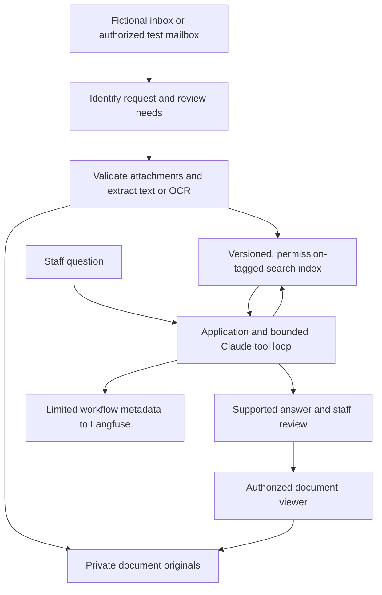

# Proposed architecture

Status: design only. The user confirmed Claude SDK chat, a visible source-based process, and Langfuse. Blob storage and Azure AI Search are proposed choices.

## User experience

Build a local executive workbench with an inbox, attachment review, chat, source-document viewer, and activity view. Use plain labels such as "What arrived," "What needs your attention," "Documents checked," and "Ready for your review." Keep SDK names, search configuration, and technical trace details in a presenter view.

Make the active mode persistent and explicit:

- **Local example:** fictional email and documents; locally scripted responses if no model is connected.
- **Live model:** a real model processes approved demo inputs. Identify which provider receives them.
- **Connected test mailbox:** actual reads from an explicitly configured test account. This is independent of the model mode.

The document parser and OCR can be real in local-example mode. Never label a scripted answer as a live model call, a local search as Azure AI Search, or a local activity timeline as a successfully exported Langfuse trace.

## Logical flow

The diagram shows proposed responsibilities, not an existing deployment. The model receives selected authorized passages; Blob Storage does not independently decide what is safe to disclose.

## Email integration

Define a common adapter for listing permitted messages, reading a selected message/thread, and downloading attachments. Implement Gmail and Microsoft Graph adapters behind that boundary. Select the first provider later; do not implement two full OAuth flows before one workflow works.

For the initial local mode, use fixture messages with attachment IDs. For a live demonstration, use a dedicated test mailbox with fictional content and narrowly scoped permissions. Backend checks enforce mailbox scope, sender/test-folder restrictions, message IDs, attachment limits, and deduplication. A label alone is not authorization to read arbitrary messages.

Initial replies stay in the local review screen. Provider draft creation is a separately visible action. Automatic receipt acknowledgments can be a later, explicitly enabled capability with loop prevention and duplicate-send controls. Do not give the model an unrestricted send-mail tool.

## Extraction and ingestion

1. Validate file type, signature, size, page count, and supported format. Reject active content and unexpected formats; do not execute macros or follow instructions embedded in files.
2. Extract embedded PDF text and spreadsheet values first. Use OCR for image-only pages and scans; keep page boundaries, OCR provenance, and field uncertainty.
3. Preserve originals and version identity; create parsed text with page, section, or sheet/cell references.
4. Apply access metadata before indexing. Do not allow an unclassified document into a shared index by default.
5. Chunk the text without discarding its source IDs and permission metadata. Generate embeddings only through a deliberately selected local or cloud provider; embeddings are another data-processing path.

Initial supported formats should be PDF, PNG/JPEG, and XLSX/CSV. DOCX may follow after the primary packet works. File formats are proposed scope, not already-supported capabilities.

## Storage and retrieval

Use a local filesystem implementation first behind a storage interface. Azure Blob Storage is the proposed cloud implementation for private originals. Use stable document IDs, version/hash, display name, media type, source message, owner, access groups, ingestion timestamp, and document date. Never place credentials or long-lived public links in metadata.

Azure AI Search can index Blob content and metadata; its [Blob indexer documentation](https://learn.microsoft.com/en-us/azure/search/search-how-to-index-azure-blob-storage) describes the supported ingestion path. OCR, chunking, embedding, and update/deletion propagation still need an explicit pipeline design.

Search should return authorized chunks with source references. Start with keyword retrieval locally, visibly labeled. A later Azure adapter can use hybrid keyword/vector retrieval, with an explicitly selected embedding model and dimensions. Assess fixed search-service cost against the size of the pilot before provisioning it.

Enforce permissions on both retrieval and document opening. Azure's available document-access mechanisms vary by source and configuration; validate the selected supported approach against [Microsoft's document-level access guidance](https://learn.microsoft.com/en-us/azure/search/search-document-level-access-overview). Do not assume storage permissions automatically protect every indexed chunk.

## Claude agent loop

Use the Claude SDK with bounded tool use. Resolve the exact SDK surface during implementation: the Claude client SDK with an application-owned loop is sufficient for narrow business tools; the Claude Agent SDK is an alternative if its orchestration is needed. Do not quietly replace an explicitly selected Agent SDK requirement later. See [Claude tools](https://platform.claude.com/docs/en/agents-and-tools/tool-use/define-tools) and the [Agent SDK overview](https://code.claude.com/docs/en/agent-sdk/overview).

Proposed tools:

| Tool | Purpose | Application control |
| --- | --- | --- |
| `search_documents` | Find relevant evidence | Server enforces current user's scope and result limits |
| `read_document_section` | Inspect an authorized page or section | Check document ID, version, section, and access again |
| `get_attachment_extraction` | Retrieve extracted fields and uncertainty | Restrict to authorized message/attachment IDs |
| `calculate_budget` | Calculate over validated numeric cells | Deterministic arithmetic; return inputs and formulas |
| `prepare_reply` | Create a local review item | No external send or financial action |

Expected loop: search -> inspect passages -> identify an evidence gap -> refine search if needed -> prepare a supported answer or ask for clarification. Cap turns, tool calls, elapsed time, context size, and cost. Tool inputs are schema-validated; authorization and action rules remain in application code.

## Showing the process and sources

Show actual events: "Searched gift conditions," "Read the reporting clause on page 2," and "Checked the sample review policy." A short model-generated explanation of a next action may accompany an event, clearly identified as an explanation. Do not claim it is a complete or literal record of hidden thought. Do not fabricate a process before tools actually run.

The final answer includes claim-level citations and a document list. Distinguish documents retrieved, documents inspected, and documents cited; a search hit is not necessarily evidence used in the answer. Clicking a citation opens the authorized original at the cited page, or a rendered extract if precise highlighting is unavailable. Spreadsheet citations include sheet and cell ranges. Preserve source version so later edits do not silently change the evidence behind an old answer.

Serve originals through an authorized backend route, or a narrowly scoped, short-lived URL issued only after authorization. An opaque document ID is not an access-control mechanism. Never let an LLM-provided path or URL select an arbitrary object.

## Langfuse

Use actual traces to connect email identification, extraction, searches, document reads, model calls, validations, and review outcomes. Keep the executive view readable and offer a presenter link into the corresponding trace. The [Langfuse observability documentation](https://langfuse.com/docs/observability/overview) describes tracing; SDK/server compatibility must be verified at implementation time.

Record measured latency, model usage, error states, and estimated cost using verified rates where available. Do not substitute an estimated cost for an invoice. Default cloud tracing to content-free metadata: random workflow IDs, operation names, counts, timings, versions, and status. A richer trace of explicitly approved fictional fixtures may be enabled separately. Never auto-capture raw email, attachments, prompts, or tool payloads in cloud traces without checking the configuration.
